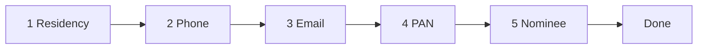

# Screener company page revamp

A redesign of a Screener-style company page for **PTC India Ltd**, built with React 19, TypeScript and Vite. It shows the company overview, a price chart, pros and cons, peer comparison, financial statements and documents. It also includes a **five-step account-opening (KYC) form** in a modal.

All data is static and lives in the front end. There is no backend or API, and nothing you enter in the form is sent anywhere.

## Getting started

Requires **Node.js 20.19+ or 22.12+** (the minimum for Vite 8).

```bash
npm install
npm run dev       # start the dev server with hot reload
npm run build     # type-check (tsc -b) and build to dist/
npm run preview   # serve the production build locally
npm run lint      # lint with oxlint (config in .oxlintrc.json)
```

## Project structure

```
index.html                  Page shell, favicon, fonts, pre-paint theme script
public/
  favicon.svg, favicon.png  Site icon (SVG plus PNG fallback)
  screener-logo.png         Logo for light mode
  screener-logo-dark.png    Logo for dark mode (light text, same green bars)
  graph.png                 Static 5-year price and volume chart
src/
  main.tsx                  React entry point
  App.tsx                   Page layout and modal open/close state
  styles.css                All styles and light/dark color tokens
  data/company.ts           All page content: company info, ratios, tables, peers, documents
  hooks/
    useTheme.ts             Light / dark / auto theme, saved to localStorage
    useActiveSection.ts     Highlights the section in view in the side nav
  components/
    Header.tsx, Footer.tsx, CompanyHero.tsx, PageNav.tsx
    Icon.tsx                Inline SVG icon set
    common.tsx              Logo, SectionCard, SectionHead, ActionButton, Segmented, FinancialTable
    sections/               Overview, PriceChart, ProsCons, PeerComparison, Financials, Documents
    onboarding/
      OnboardingModal.tsx   Modal, stepper and step navigation
      steps.tsx             One component per step, plus the done screen
      form.ts               Form types, initial state, step list and validation
```

## Multi-step onboarding form

The form is a modal with five steps, a progress stepper and a confirmation screen:



### Opening and closing

- **Opens from** the header's **Get started** button, the hero's **Follow** button and the side nav's **Open an account** button.
- **Closes with** the × button, the **Escape** key, **Back** on step 1, or **Back to PTC India** on the done screen. Clicking the backdrop does not close it.
- **Reopening** always starts again at step 1, but earlier answers are kept, so the user doesn't have to retype them. Answers live only in React state, so a page reload clears them.

### Steps and validation

**Continue** checks the current step. If something is missing, the step stays put and one error message appears under the buttons. The message clears as soon as the user edits any field.

| # | Step | Fields | Must be true to continue (message shown otherwise) |
|---|------|--------|------------------------------------------------------|
| 1 | **Residency** | Indian Resident or NRI (radio cards) | A choice is made ("Please choose your residency status.") |
| 2 | **Phone** | Country code, phone number, **Send OTP**, 6-digit OTP | At least 10 digits ("Enter a valid 10-digit phone number."); OTP has been sent ("Send and enter the OTP to continue."); OTP is 6 digits ("Enter the 6-digit OTP sent to your phone.") |
| 3 | **Email** | Email address, **Send code**, 6-digit code | Email matches `name@domain.tld` ("Enter a valid email address."); code has been sent ("Send and enter the code to continue."); code is 6 digits ("Enter the 6-digit code sent to your email.") |
| 4 | **PAN** | PAN number, name as per PAN, date of birth | PAN matches `ABCDE1234F` (five letters, four digits, one letter) ("PAN must look like ABCDE1234F."); name is not blank ("Enter your name as printed on your PAN."); date of birth is set ("Select your date of birth.") |
| 5 | **Nominee** | 1 to 4 nominees, each with full name, relation and share % | Every nominee has a name and a relation ("Each nominee needs a name and a relation."); shares add up to exactly 100% ("Nominee shares must add up to exactly 100%.") |

Checks run in the order listed, and only the first failing message is shown.

### Step details

- **Residency:** choosing *Indian Resident* also resets the country code to +91. The choice changes the help text on the phone step and the wording on the done screen.
- **Phone:**
  - Country codes are +91, +971, +65, +44 and +1.
  - The number field accepts only digits and spaces.
  - After **Send OTP** the button turns into a green **SENT** badge and the OTP field appears.
  - **Resend OTP** clears the OTP field.
- **Email:** same pattern as the phone step, using **Send code**.
- **OTP fields:** accept digits only, up to 6, with `autocomplete="one-time-code"` so phones can autofill them.
- **PAN:** input is uppercased as you type, non-alphanumeric characters are removed, and it is capped at 10 characters.
- **Nominee:**
  - **Add nominee** is disabled at the maximum of 4, and **Remove** is disabled when only one nominee is left.
  - A live "Allocated X% of 100%" counter turns green at exactly 100%.
  - The total is rounded to two decimals, so 33.3 + 33.3 + 33.4 counts as 100.
- **Last step and done screen:**
  - On the last step, **Continue** becomes **Submit**.
  - After it, the stepper is hidden and the done screen shows "You're all set", the account type and the email address the confirmation will go to.

### Stepper and navigation

- The stepper shows a **check icon** for completed steps, highlights the **current** step and greys out steps still to come.
- A "*n* of 5" counter sits next to the primary button.
- **Back** goes to the previous step without validating, and clears any error message.
- The user can't skip ahead: the only way forward is **Continue**, which validates the current step.

### How it works

- **One state object.** All answers live in a single `OnboardingForm` object in `OnboardingModal`. The initial values are `initialForm` in `form.ts`.
- **Updating answers.** Each step component gets `form` and an `update(patch)` function. `update` merges a partial object into the form and clears the current error. Step components never own any form state themselves.
- **Validation.** `validateStep(step, form)` in `form.ts` is a pure function. It returns the blocking message, or `''` when the step is complete. `OnboardingModal` calls it on **Continue**, which makes it the one place to change a rule and easy to unit-test.
- **Step numbering.** `STEP_LABELS` defines the steps. `LAST_STEP` and `DONE_STEP` are derived from its length, so the stepper, the counter and the Submit label update automatically.
- **Nominee limit.** The maximum number of nominees is a prop: `<OnboardingModal maxNominees={4} />`. The default is 4.

### Adding or changing a step

1. Add the label to `STEP_LABELS` in `form.ts`, and any new fields to `OnboardingForm` and `initialForm`.
2. Add a `case` for the new step number to `validateStep`, and renumber the cases after it.
3. Create the step component in `steps.tsx`. It takes `{ form, update }`.
4. Render it in `OnboardingModal.tsx` next to the others: `{step === n && <NewStep form={form} update={update} />}`.

### What is simulated

This is a front-end prototype. When wiring it to a real backend:

- **OTP and email codes aren't sent.** **Send OTP** / **Send code** only reveal the code field, and any 6 digits are accepted.
- **PAN isn't checked against any records.** Only its format is validated.
- **Submit doesn't send anything.** It just moves to the done screen.
- **Changing the phone number or email after sending a code** doesn't reset the "sent" state or the entered code.
- **Phone length:** the check requires *at least* 10 digits, not exactly 10, whatever the country code.
- **Nominee shares:** individual shares aren't checked, only the total. A nominee with an empty share passes as long as the others add up to 100%.
- **Date of birth:** there is no minimum-age check.

## Page features

- **Theme.** The header button switches between light and dark. `useTheme` saves the choice in `localStorage` (`screener-theme-mode`). A small script in `index.html` applies it before the first paint to avoid a flash of the wrong theme. The hook also supports `auto` (follow the system setting), but no control currently selects it.
- **Colors.** Light and dark palettes are CSS variables at the top of `styles.css` (`:root` and `:root[data-theme="dark"]`). Secondary text uses `--muted`, which passes 4.5:1 contrast in both themes.
- **Side nav.** `useActiveSection` uses an `IntersectionObserver` to highlight the section currently in the top third of the screen.
- **Price chart.** The chart is the static image `public/graph.png`. The range, metric and legend controls respond to clicks, but they don't change the image.
- **Page content.** All company figures, tables, peers and documents come from `src/data/company.ts`. Edit that file to change what the page shows.
- **Icons.** Icons are inline SVGs from `Icon.tsx`, sized to `1em` so they scale with the surrounding text. The UI uses no emoji or symbol characters as icons.
- **Logo.** `Logo` renders both logo images, and CSS shows the one matching the theme. If you change `screener-logo.png`, regenerate `screener-logo-dark.png` to match.
- **Footer.** Three bands: a data-status strip (market status, price timestamp, financials basis, data source), a disclaimer with links, and a legal line.
- **Responsive.** Below 900px the side nav and header links are hidden and the layout becomes one column. Below 600px, padding tightens, the search box is hidden, and the nominee fields rearrange: the name takes the full row, with relation and share below it.

## Tech stack

React 19 · TypeScript 6 · Vite 8 (`@vitejs/plugin-react`) · Oxlint · IBM Plex Sans / Mono (Google Fonts). The app has no runtime dependencies beyond React.
